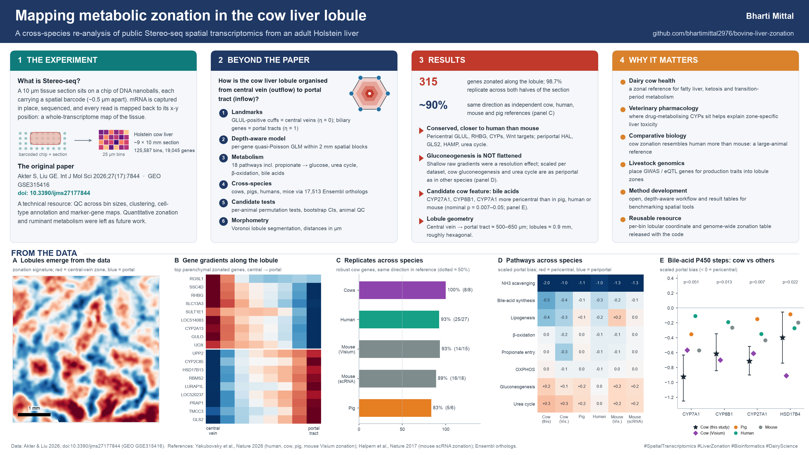

# Metabolic zonation of the bovine liver lobule from Stereo-seq spatial transcriptomics

A re-analysis of a public Stereo-seq dataset of adult Holstein cattle liver
([GEO GSE315416](https://www.ncbi.nlm.nih.gov/geo/query/acc.cgi?acc=GSE315416);
Akter & Liu, *Int J Mol Sci* 2026). The original publication describes the dataset and its quality.
This project asks the biological questions it leaves open: how gene expression is organised along the
lobule from central vein to portal tract, where ruminant-relevant metabolic pathways sit along that axis,
and how bovine zonation compares with pig, human and mouse.

**Author:** Bharti Mittal
**Report:** [`report/Bovine_liver_zonation_report.docx`](report/Bovine_liver_zonation_report.docx)



## Main findings

| Question | Result |
|---|---|
| Can a central-to-portal lobular coordinate be built from Stereo-seq alone? | Yes. GLUL⁺ central-vein domains and biliary-positive portal tracts give a two-landmark axis (η) covering 52% of tissue bins. 12 of 14 independent zonation markers have the expected direction. |
| How much of the transcriptome is zonated? | 315 of 5,524 genes (FDR < 0.05, ≥ 1.4-fold). 98.7% keep their direction in both halves of the section, which differ in sequencing depth. 134 have smooth gradients across the hepatocyte parenchyma (72 pericentral, 62 periportal). |
| Does it replicate across species and platforms? | For robust bovine genes that are clearly zonated in a reference, the direction agrees in 8/8 genes in independent cows, 25/27 in human, 14/15 in mouse Visium, 16/18 in mouse scRNA-seq and 5/6 in pig. |
| Is periportal gluconeogenesis flattened in the ruminant? | No. After scaling each dataset by its own CYP gradient, bovine gluconeogenesis and urea-cycle zonation is as strong as in pig, mouse and human. Propionate-entry enzymes, β-oxidation and OXPHOS are flat in every species. |
| Candidate ruminant-specific features | The P450 steps of bile-acid synthesis (CYP27A1, CYP8B1, CYP7A1, plus HSD17B4) are more pericentral in both cow sources than in any control species (nominal p = 0.007–0.05; not significant after FDR correction). A post-hoc observation: FXR (NR1H4) and NTCP (SLC10A1) lean periportal in cow. A pericentral shift of de novo lipogenesis was not supported. |
| Lobule geometry | Central vein to portal tract is about 500–650 µm. CV-centred lobules are about 0.9 mm in equivalent diameter, roughly hexagonal with a median of 6 neighbours. The GLUL⁺ pericentral cuff is about 120 µm across. |

## Repository layout

```
scripts/
  lobule_utils.py                         shared helpers (grid, landmarks, batched quasi-Poisson GLM)
  00_portal_landmark_feasibility.py       can portal tracts be located?
  01_lobular_axis_zonation.py             lobular coordinate + genome-wide zonation
  02_ruminant_metabolism_zonation.py      pathway zonation (18 curated sets)
  03a_fetch_references.sh                 downloads cross-species reference tables + Ensembl orthologs
  03_cross_species_zonation.py            cow vs pig / human / mouse
  04_ruminant_candidates_bile_acid_lipogenesis.py   gene-level tests with per-animal controls
  05_lobule_morphometry.py                lobule segmentation and morphometry
results/      tables produced by each script (prefix = script number)
figures/      multi-panel figures (PNG + PDF)
data/01_bin50_lobular_coordinate.csv.gz   per-bin lobular coordinate (η, distances to landmarks)
report/       project report (Word)
infographic/  one-page summary image
```

## Reproducing the analysis

1. Create the environment: `conda env create -f environment.yml`.
2. Inputs are bin50 (25 × 25 µm) AnnData objects for sample GSM10044212, made from the GEO
   `tissue.gef` file:
   - `GSM10044212_bin50_QC_filtered.h5ad`: raw counts after bin-level QC.
   - `GSM10044212_bin50_GLUL_consensus_components.h5ad`: the same bins with a
     `GLUL_consensus_frequency` column (0–9). It records how many of 9 parameter settings call the bin
     part of a local GLUL-enriched domain.

   Place them in `<data>/processed_data/` and point to `<data>` with
   `export BOVINE_LIVER_DATA=/path/to/data`. The default is `../GSE315416`.
3. Run in order:
   ```
   python scripts/00_portal_landmark_feasibility.py
   python scripts/01_lobular_axis_zonation.py
   python scripts/02_ruminant_metabolism_zonation.py
   bash   scripts/03a_fetch_references.sh       # ~650 MB download, needs openpyxl
   python scripts/03_cross_species_zonation.py
   python scripts/04_ruminant_candidates_bile_acid_lipogenesis.py
   python scripts/05_lobule_morphometry.py
   ```

## Methods in brief

- **Lobular coordinate.**
  - Central veins: GLUL consensus domains (≥ 7/9).
  - Portal tracts: smoothed foci of biliary and portal-mesenchyme genes, kept only when biliary genes are
    ≥ 2-fold enriched.
  - η = d_CV / (d_CV + d_PT), excluding bins within 50 µm of a landmark or with a CV–PT span over 1.5 mm.
- **Zonation model.** Pseudobulk over 2 mm spatial blocks × 8 η layers. For each gene, a quasi-Poisson GLM
  `block + poly3(η) + log(library size)` is fitted; the block term absorbs regional depth differences.
  Robust genes must also replicate in both halves of the section and across six landmark definitions.
- **Cross-species.**
  - References: Visium zonation tables for human, cow, pig and mouse (Yakubovsky et al. 2026) and mouse
    hepatocyte scRNA-seq (Halpern et al. 2017).
  - Genes matched by Ensembl one-to-one orthologs.
  - Metric: portal bias = log2(last two layers / first two layers).
  - Pathways are also compared after scaling by each dataset's own CYP gradient.
- **Candidate tests.** Per-animal portal bias scaled by the animal's CYP2E1 + CYP1A2 gradient. Animals are
  excluded when their own anchor genes show a mis-oriented axis. Exact one-sided permutation tests compare cows
  with pig, human and mouse, and this sample gets a spatial-block bootstrap CI.
- **Morphometry.** Marker landmarks plus peaks of a zonation signature, CV-centred Voronoi lobules, and
  nearest-neighbour distances.

## Limitations

- One tissue section from one animal; the independent Visium cows are noisy (one failed axis QC).
- Bin50 mixes 2–4 hepatocytes with non-parenchymal cells, so effect sizes are smaller than in single-cell data.
- Landmark detection is incomplete (GLUL is detected in about 4% of bins), so marker-based distances are upper bounds.
- The candidate ruminant features are nominal and need more animals.

## Data sources

- Akter S, Liu GE. *Int J Mol Sci* 2026;27(17):7844. doi:10.3390/ijms27177844 (dataset GSE315416)
- Yakubovsky O, et al. *Nature* 2026;653:1148–1157. doi:10.1038/s41586-026-10377-y
- Halpern KB, et al. *Nature* 2017;542:352–356. doi:10.1038/nature21065
- Ensembl BioMart (cattle–human–mouse orthologs)

## License

MIT, see [LICENSE](LICENSE).
